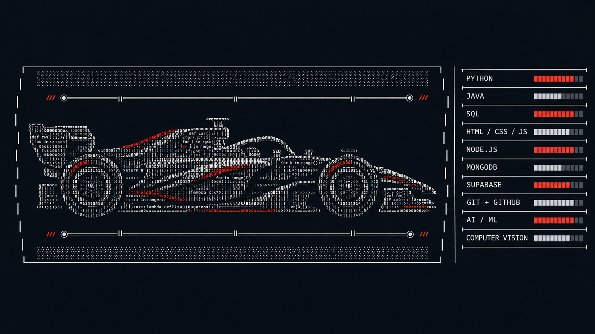

 

## /// THE DRIVER

> **B.Tech AI & Machine Learning student at Woxsen University · Class of 2028**  
> Building practical, high-performance experiences across intelligent systems, web development, and creative technology.

- 🏎️ Tuning: **AI/ML, computer vision & interactive applications**
- 🧠 Building with: **Python, Java, web technologies & databases**
- 📡 Principle: **learn fast · build deliberately · ship clean**

---

## /// MY CAR-EER

---

## /// SELECTED RUNS

> 🏁 **STARTING GRID** — six finished laps, each a different circuit.

| LAP | RACE CARD | RACE SPEC |
|:--:|:--|:--|
| 🟥 01 | **Customer Churn Prediction** · _Data Science GP_ | Python · Scikit-learn · Streamlit |
| 🟦 02 | **HUMAInITY** · _Human-Centred AI Circuit_ | AI/ML · UX |
| 🟩 03 | **LoFiChat** · _Realtime Sprint_ | Web · Realtime systems |
| 🟨 04 | **Health Prediction System** · _Clinical Endurance Race_ | ML · Data analysis |
| 🟪 05 | **E-Commerce Platform** · _Full-Stack Grand Prix_ | Java · Web · Database |
| 🟧 06 | **Hackathon Builds** · _24-Hour Night Race_ | Rapid prototyping · Teamwork |

---

## /// LIVE TELEMETRY

*Designed for speed · Built with curiosity · Based in India, working worldwide.*
